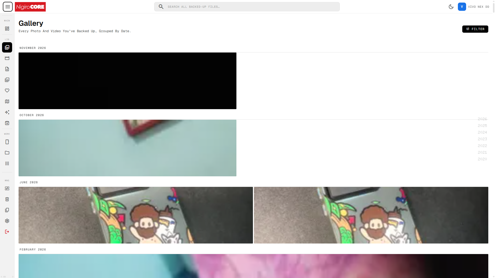
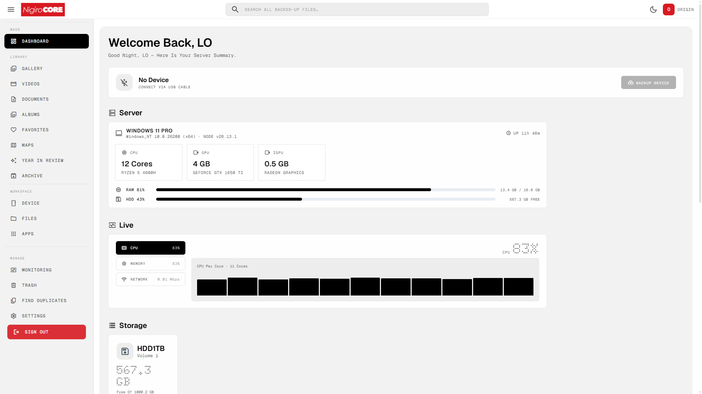
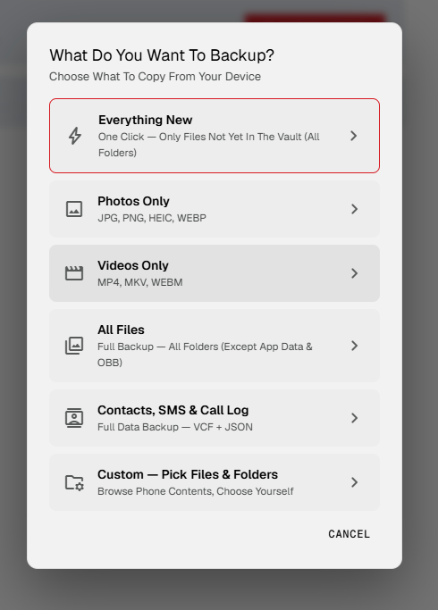
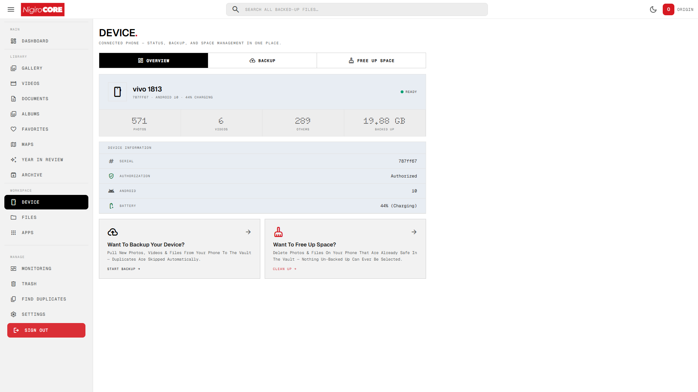
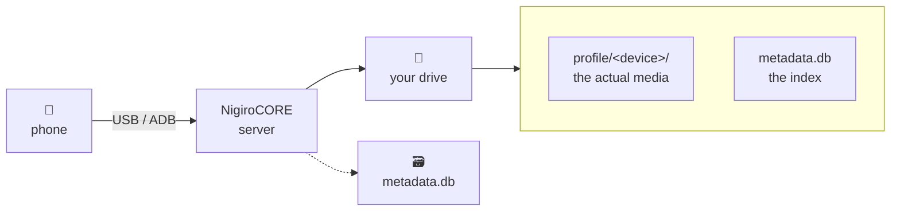

<p align="center">
  
</p>

<p align="center">
  Self-hosted backup for your phone. Plug in over USB, press one button,<br/>
  and your photos land on your own drive. That's it.<br/>
  No cloud. No account. No subscription.
</p>

<p align="center">
  
  
  
</p>

---

I got tired of photo services. Either they compress everything, or they want a monthly fee, or the real product turns out to be *you*. Every "free unlimited photos" plan has a business model, and the business model isn't you keeping your photos.

So this is the boring alternative: a server that runs on your own machine, pulls files off your phone over USB, and puts them in a folder. The folder is yours. Copy it, back it up, put it on two disks, delete the app — your photos don't care. They're just files.

There's a web UI for browsing them (justified gallery, year scrubber, favorites, albums — the things I actually missed from Google Photos), but the core of it is dumb in the best way: files go from the phone to the disk, verified by checksum, and nothing on the phone is ever touched.

## Preview

| Gallery | Dashboard |
|---|---|
|  |  |
| *Gallery — justified layout, date headers, year scrubber* | *Live monitoring — CPU, RAM, disks, network* |

| Backup | Device |
|---|---|
|  |  |
| *Backup progress with byte-level ETA* | *Device hub — profiles per phone* |

## What it does

- **USB backup, manual trigger** — presets like *Everything New* or *DCIM*, or pick folders yourself. Byte-level progress with ETA. A 30s watchdog handles flaky cables.
- **Gallery that doesn't suck** — justified layout, date headers, year scrubber, favorites, albums, trash with restore. Videos stream with range requests, so seeking is instant.
- **Checksum everything** — SHA-1 per file, dedup on insert, and an integrity job that flags anything missing or corrupted.
- **Live monitoring** — CPU, RAM, disks, network, drawn as dot-matrix charts because I like dot-matrix charts.
- **Survives disk swaps** — paths in the database are relative to the storage root. Drive letter changed? Disk moved to another machine? Nothing breaks.
- **Pre-flight checks** — on startup it checks storage, database, port, and ADB, and tells you in plain English what's wrong instead of dumping a stack trace.

## Requirements

- Node.js 26+ (it uses the built-in `node:sqlite`)
- Windows, with [ADB platform-tools](https://developer.android.com/tools/releases/platform-tools) somewhere findable
- A drive with room for your media

## Quick start

```
git clone https://github.com/ErickOrigin/NigiroCORE.git
cd NigiroCORE
npm install
node setup.js
node server/server.js
```

`setup.js` walks you through it: where media should live, where the index should live (it detects SSD vs HDD and suggests accordingly), where adb.exe is. Then open http://localhost:3000.

There are also three launcher scripts if you'd rather not think about it:

| | |
|---|---|
| `start-nigiro.vbs` | start silently, opens the browser |
| `start-nigiro-debug.vbs` | start with a visible console (Ctrl+C to stop) |
| `stop-nigiro.vbs` | stop it |

## How it's built

One Node.js server, no build step, no framework, no bundler. The frontend is a single `app.js` and `index.html` styled with a small Nothing-inspired design kit. The index is SQLite (built into Node via `node:sqlite`), so there's no database server to install. Dependencies: express, sharp, exifr, dotenv, and a couple of small helpers — that's the whole list.



<details>
<summary>Prefer it plain?</summary>

```
phone ── USB/ADB ──> NigiroCORE server ──> your drive
                     │                     ├─ profile/<device>/   the actual media
                     └─ metadata.db        └─ metadata.db         the index
```

</details>

## Wait, did you use AI?

Yes. I'm a dental student — I don't know how to code. This whole project was built by talking to an AI: describing what I wanted, testing it, breaking it, and asking it to fix what I broke. Every feature in this app started as a complaint ("why is finding an old photo so annoying?") and ended as a conversation.

So if you're a developer reading this and something in the code makes you wince — that's fair. It works, it's tested, but it was written by someone who learned what a "port" was last year. Be nice.

## Safety model

Worth stating plainly, because "backup software that deletes your stuff" is a genre:

| | |
|---|---|
| The phone is read-only | Backup is `adb pull` only. The app has no code path that deletes or moves anything on the device. |
| Copies are verified | SHA-1 checksum on every file; mismatches get flagged, not silently ignored. |
| Duplicates are caught | Same checksum = same file, stored once. |
| A missing disk isn't a crisis | Pre-flight notices the storage is gone and waits, retrying every 5 seconds, instead of writing error #482 into the log. |
| Nothing phones home | Zero telemetry. The server makes no outbound calls. |

## Free Minecraft Server

There is no free Minecraft server. There has never been a free Minecraft server. We just wanted to see if you were still reading.

(If you actually came here for a free Minecraft server: this app backs up your phone over USB. Wrong repo. But honestly? You're closer to your goal than you think — half the Minecraft server videos on YouTube were filmed next to a guy who also backs up his phone.)

---

## Star History

<a href="https://www.star-history.com/?repos=ErickOrigin%2FNigiroCORE&type=date&legend=top-left">
 <picture>
   <source media="(prefers-color-scheme: dark)" srcset="https://api.star-history.com/chart?repos=ErickOrigin/NigiroCORE&type=date&theme=dark&legend=top-left" />
   <source media="(prefers-color-scheme: light)" srcset="https://api.star-history.com/chart?repos=ErickOrigin/NigiroCORE&type=date&theme=light&legend=top-left" />
   
 </picture>
</a>

## License

[AGPL-3.0](LICENSE) © 2026 ErickOrigin — free to use, modify, and build upon. If you distribute a modified version (even as a server), it must stay open source under the same license. No warranty: your data is your responsibility (though we do checksum it).
